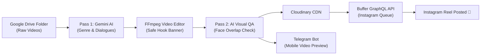

# 🚀 Universal Instagram Reels AI Autopilot (Zero-Prompt Engine)

> **Autonomous 24/7 Multimodal AI publishing engine for Instagram Reels.**  
> Point it to any Google Drive folder containing raw vertical videos, and it autonomously handles **content understanding, viral hook overlays, face-safe visual quality checks, niche-specific hashtags, cloud scheduling via Buffer, and Telegram mobile previews.**

---

## 👑 Credits & Authorship

* 💡 **Conceived, Designed & Directed by:** **Sunny Patel** ([@sunnyptl95](https://github.com/sunnyptl95))
* ⚡ **Architected & Engineered with:** **Antigravity AI (Google DeepMind)**
* 📜 **License:** [MIT License](LICENSE) — Free for open-source use and community contribution.

---

## ✨ Key Capabilities

* 🧠 **Zero-Prompt Multimodal Intelligence:** Whether your videos are about **Gym/Fitness, AI & Tech, Comedy/Memes, Business/Finance, Motivation, Anime, or Podcasts**, Gemini Multimodal AI watches and listens to the video, automatically detects the genre, and writes high-retention hooks without requiring manual prompts.
* 🛡️ **Two-Pass Visual QA & Face Clearance:** 
  * **Pass 1 (Pre-Edit):** Calculates safe Y-zone positioning to avoid cutting through faces or existing text.
  * **Pass 2 (Post-Edit):** AI visually inspects the rendered frame. If any character or human face is obscured, it auto-repositions or cleanly falls back.
* 🎬 **High-Contrast Safe Banner Overlay:** FFmpeg draws bold, mobile-optimized hook banners with semi-transparent contrast boxes and auto line-wrapping.
* 📊 **Buffer Free-Tier Guard:** Checks queue depth and strictly caps scheduled posts at **10/10**, pausing gracefully until slots clear.
* ☁️ **Cloudinary CDN Integration:** Direct video hosting compatible with Instagram Graph API requirements.
* 📱 **Mobile Telegram Alerts:** Sends full preview video, captions, hashtags, and visual QA scores to your phone.
* ⏰ **100% Cloud-Native (₹0 / $0 Cost):** Runs automatically 2 times daily on **GitHub Actions** (No servers, VPS, or running computers needed).

---

## 🏗️ Architecture Flow

---

## ⚡ 5-Minute Quickstart (BYOK - Bring Your Own Keys)

This is a **100% Bring-Your-Own-Keys (BYOK)** open-source template. You need to obtain your own free credentials:

### 1. Fork this Repository
Click the **Fork** button at the top right of this repository to create your own copy.

### 2. Prepare Your Free Credentials
Get your free API keys from the official providers:
1. **Google Gemini API Key:** [Google AI Studio](https://aistudio.google.com/) (Free)
2. **Buffer Account:** [Buffer.com](https://buffer.com/) (Free tier connects up to 3 channels)
   - Obtain your `BUFFER_ACCESS_TOKEN`, `BUFFER_CHANNEL_ID`, and `BUFFER_ORG_ID`.
3. **Cloudinary CDN:** [Cloudinary.com](https://cloudinary.com/) (Free tier provides generous media storage)
   - Obtain `CLOUDINARY_CLOUD_NAME`, `CLOUDINARY_API_KEY`, and `CLOUDINARY_API_SECRET`.
4. **Telegram Bot:** Create a bot via [@BotFather](https://t.me/BotFather) on Telegram and get your Chat ID via [@userinfobot](https://t.me/userinfobot).
5. **Google Drive Folder:** Upload your vertical reels/videos to a Google Drive folder and set sharing to *"Anyone with the link can view"*.

### 3. Add GitHub Secrets
In your forked GitHub repository:
Go to **Settings** -> **Secrets and variables** -> **Actions** -> **New repository secret**, and add:

| Secret Name | Description |
| :--- | :--- |
| `GEMINI_API_KEY` | Your Google Gemini API Key |
| `BUFFER_ACCESS_TOKEN` | Buffer GraphQL Access Token |
| `BUFFER_CHANNEL_ID` | Instagram Channel ID from Buffer |
| `BUFFER_ORG_ID` | Buffer Organization ID |
| `CLOUDINARY_CLOUD_NAME` | Cloudinary Cloud Name |
| `CLOUDINARY_API_KEY` | Cloudinary API Key (Digits) |
| `CLOUDINARY_API_SECRET` | Cloudinary API Secret |
| `TELEGRAM_BOT_TOKEN` | Telegram Bot Token from BotFather |
| `TELEGRAM_CHAT_ID` | Your Telegram User/Chat ID |
| `GDRIVE_FOLDER_URL` | Shareable link to your Google Drive folder |

### 4. Enable Workflow Permissions
Go to **Settings** -> **Actions** -> **General** -> scroll to **Workflow permissions** -> Select **"Read and write permissions"** -> Click **Save**.

### 5. Run & Enjoy Autopilot! 🚀
* Go to the **Actions** tab in GitHub.
* Click **Universal Instagram Reels Autopilot** -> Click **Run workflow**.
* Your reel will be edited, scheduled to Buffer, and delivered to your Telegram!

---

## 📦 Upcoming: Ready-to-Post Content Vaults

Don't have videos to post? We are preparing curated, high-retention Google Drive vaults:
* 🔥 **500+ Gym & Sigma Motivation Vault**
* 🤖 **300+ AI, Robotics & Futuristic Tech News Vault**
* 🧠 **400+ Stoic Mindset & Philosophy Vault**
* 🤣 **500+ Desi Comedy & Animated Skits Vault**

*(Stay tuned or star the repository for updates!)*

---

## 📄 License

Distributed under the **MIT License**. See [LICENSE](LICENSE) for more information.
Created with passion by **Jaynil Patel** ([@sunnyptl95](https://github.com/sunnyptl95)).
